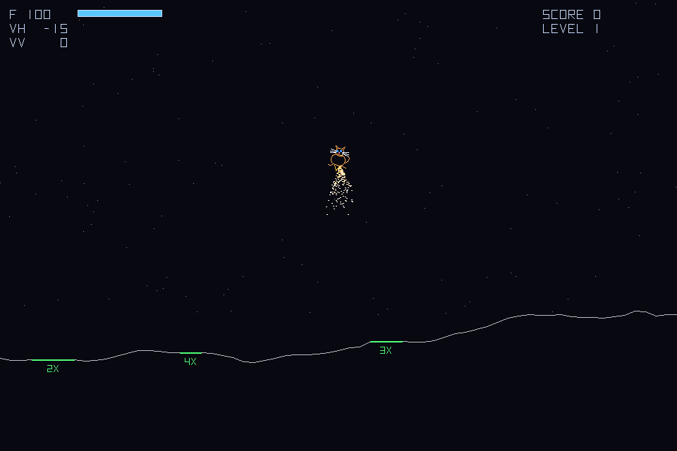
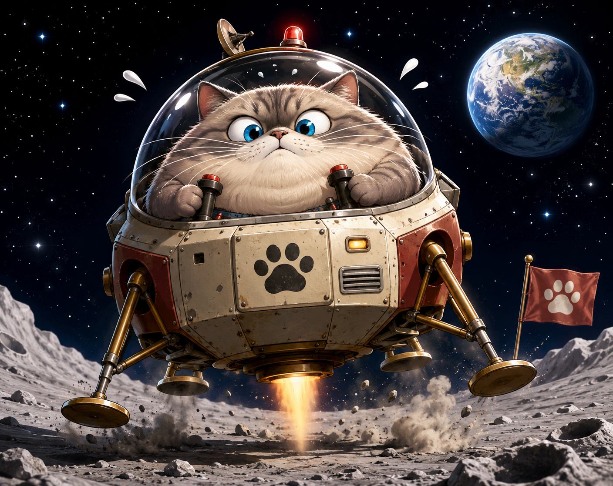

# Lunar Lander — starring Eagle the Fat Cat

A classic arcade lunar lander in a single file of C17 + SDL2, playable
natively or in the browser via WebAssembly. The pilot is Eagle: a very
round cat with excellent whiskers, blue eyes, and a rocket strapped to
his backside.



Eagle himself, at 6x magnification:


And as the box art insists he truly is:



*(A gorgeous box and 8-bit graphics — the best tradition of the 1980s.)*

## Play

- **LEFT / RIGHT** (or **A / D**) — rotate
- **UP** (or **W**) — thrust
- **P** — pause, **ESC** — end flight, **R** — continue
- **SPACE** — start from the title screen

Land upright on a green pad: descent under 28, lateral drift under 18,
tilt under ~11 degrees. Score is 50 x the pad multiplier plus remaining
fuel — narrower pads pay more. Each level the terrain gets rougher,
gravity stronger, and the pads narrower. A crash ends the run. The top
eight flights are remembered on the high-score table.

## Build

Native (needs SDL2 development headers, e.g. `apt install libsdl2-dev`):

```sh
make
./lander
```

Browser (needs the [Emscripten SDK](https://emscripten.org/docs/getting_started/downloads.html);
`source emsdk_env.sh` first):

```sh
make wasm
python3 -m http.server     # then open http://localhost:8000/index.html
```

Package for itch.io (produces `lander-itch.zip`; upload as an HTML
project and tick "This file will be played in the browser"):

```sh
make itch
```

## Tests

```sh
make test
```

Two harnesses `#include lander.c` directly, so they always exercise the
exact shipping code:

- `terrain_test` generates 16,000 terrains (2,000 seeds x 8 levels) and
  asserts every vertex is inside the window, every slope is bounded,
  and every landing pad is flat under the same interpolation the
  collision code uses.
- `hiscore_test` checks high-score ordering, the table cap, score
  qualification, the default pilot name, and a save/load round trip.

## Design notes

- **Physics**: semi-implicit (symplectic) Euler; lunar-ish gravity,
  thrust along the body axis, fuel burn, horizontal screen wrap.
- **Terrain**: midpoint-displacement heightmap (2^k + 1 vertices),
  slope-limited so cliffs stay flyable, with flat pads carved in and
  their edges blended back under the slope cap.
- **Sound**: synthesized live in the SDL audio callback — filtered
  noise for thrust, a decaying noise burst for the crash, a rising
  arpeggio for touchdown. No assets, no SDL_mixer.
- **Text**: a hand-rolled vector stroke font (A-Z, 0-9), so there is no
  SDL_ttf dependency and the WASM build stays small.
- **High scores**: a plain text file natively; an IndexedDB-backed
  IDBFS mount in the browser, so scores persist across sessions
  (per browser — it is a local table, not a global leaderboard).
- **One file**: everything above is ~900 lines of C17 in `lander.c`.
  The only dependency is SDL2.

## Credits

- Programming and physics: the management
- Character design and art direction: the management's wife
- Starring: Eagle the Fat Cat
- In the tradition of: Atari's *Lunar Lander* (1979) and every 1980s
  game whose box art wrote checks the pixels gleefully declined to cash

## License

GPL-3.0-or-later. See [LICENSE](LICENSE).
